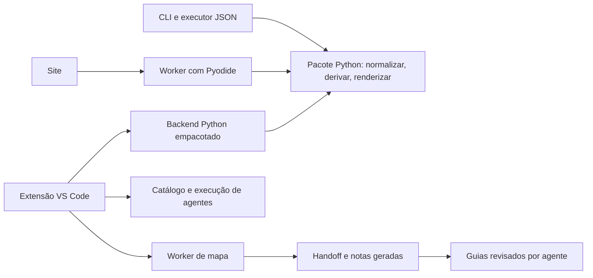

# Arquitetura verificada do Nestor Forge

Esta é a entrada das **notas manuais** de arquitetura. A leitura partiu de `.agentorchestra/context/project-handoff.json` (revisão registrada `28a5868`, mapa gerado em 2026-10-15) e confirmou responsabilidades em trechos de código. O handoff é um índice de navegação: para projetos sem classificação explícita ou Laravel, seu agrupador usa a primeira pasta relevante como `directory` ([`vscode-extension/src/projectMap.js:77`](../../../vscode-extension/src/projectMap.js#L77), [`vscode-extension/src/projectMap.js:103`](../../../vscode-extension/src/projectMap.js#L103)). O estado da árvore de trabalho pode ser posterior à revisão do mapa.

Cada nota usa referências `arquivo:linha`. **Confirmado** indica comportamento observado no código; **Inferência** indica uma conclusão arquitetural apoiada nos fluxos; **Não verificado** indica um contrato ou resultado que ainda exige execução ou leitura adicional. Documentação de uso existente em [`README.md`](../../../README.md), [`vscode-extension/README.md`](../../../vscode-extension/README.md) e [`docs/AGENT_RUNNER.md`](../../AGENT_RUNNER.md) continua sendo fonte de instruções para usuários. [`docs/INTEGRACOES.md`](../../INTEGRACOES.md) contém propostas e não deve ser lido como inventário de funcionalidades implementadas ([`docs/INTEGRACOES.md:3`](../../INTEGRACOES.md#L3)).

## Visão do sistema

O núcleo Python orquestra normalização, derivação e renderização de especificações ([`nestor_forge/compiler.py:40`](../../../nestor_forge/compiler.py#L40)). O site copia esse núcleo para o navegador via Pyodide; a extensão o empacota em `vendor/` para sua ponte Python ([`site/forge-worker.js:5`](../../../site/forge-worker.js#L5), [`scripts/bundle_extension_backend.py:5`](../../../scripts/bundle_extension_backend.py#L5)). A extensão também oferece catálogo, execução e mapeamento, implementados em JavaScript e conectados a partir de `activate` ([`vscode-extension/src/extension.js:9`](../../../vscode-extension/src/extension.js#L9), [`vscode-extension/src/extension.js:470`](../../../vscode-extension/src/extension.js#L470)).

## Guias por responsabilidade

| Pergunta | Guia | Entradas principais |
| --- | --- | --- |
| Como uma especificação vira arquivos de agente? | [Geração de agentes](agent-generation.md) | CLI, JSON, extensão e formulário web |
| Como a página gera ZIPs e como site/VSIX são entregues? | [Site e distribuição](site-and-distribution.md) | Worker Pyodide, build do site e pacote da extensão |
| Como agentes e skills são encontrados e executados? | [Catálogo e execução](agent-orchestration.md) | Árvore e comandos do VS Code |
| Como funcionam monitoramento, painel, compartilhamento e atualização? | [Integrações da extensão](extension-integrations.md) | APIs do VS Code, CLI e backend local |
| Como o mapa e as notas automáticas são produzidos? | [Mapa e documentação](project-documentation.md) | Worker Node, configuração e handoff |
| O que o parser e o diff estrutural realmente reconhecem? | [Análise estrutural](structural-analysis.md) | Parsers, taxonomia e Git |
| Como são montados, publicados e verificados os artefatos? | [Entrega e verificação](delivery-and-verification.md) | Scripts, testes e CI |

## Classificação dos grupos do handoff

| Grupo | Classificação confirmada ou inferida | Evidência |
| --- | --- | --- |
| `nestor_forge/` | **Pacote Python** e núcleo da geração de agentes. | [`pyproject.toml:13`](../../../pyproject.toml#L13), [`nestor_forge/compiler.py:9`](../../../nestor_forge/compiler.py#L9) |
| `vscode-extension/` | **Pacote de extensão VS Code** com catálogo, execução, mapa e integrações; não é um único módulo de negócio. | [`vscode-extension/package.json:11`](../../../vscode-extension/package.json#L11), [`vscode-extension/src/extension.js:9`](../../../vscode-extension/src/extension.js#L9) |
| `site/` | **Interface web** da geração de agentes e página de distribuição. | [`site/index.html:7`](../../../site/index.html#L7), [`site/app.js:316`](../../../site/app.js#L316) |
| `scripts/` | **Automação e ferramentas de manutenção**, incluindo build, executor JSON e análise de commits. | [`scripts/build_site.py:18`](../../../scripts/build_site.py#L18), [`scripts/agent_run.py:86`](../../../scripts/agent_run.py#L86), [`scripts/commit_ast.py:252`](../../../scripts/commit_ast.py#L252) |
| `examples/` | **Dados de exemplo e fontes de pacotes de demonstração**, inclusive três especificações de agentes de contexto. | [`scripts/build_context_agents.py:16`](../../../scripts/build_context_agents.py#L16), [`scripts/build_context_agents.py:43`](../../../scripts/build_context_agents.py#L43) |
| `tests/` | **Verificações** do compilador, CLI, build do site, navegador e ferramenta de commit. | [`tests/test_forge.py:40`](../../../tests/test_forge.py#L40), [`tests/test_commit_ast.py:13`](../../../tests/test_commit_ast.py#L13), [`tests/browser_smoke.mjs:35`](../../../tests/browser_smoke.mjs#L35) |
| `docs/` | **Documentação de uso e de integração**; `docs/architecture/` abriga saídas geradas e estas notas manuais. | [`docs/AGENT_RUNNER.md:1`](../../AGENT_RUNNER.md#L1), [`vscode-extension/src/projectDocs.js:160`](../../../vscode-extension/src/projectDocs.js#L160) |
| `.github/` | **Infraestrutura de publicação** do site e VSIX. | [`.github/workflows/pages.yml:17`](../../../.github/workflows/pages.yml#L17) |
| `.vscode/` | **Configuração local do editor**. Não aparece como entrada de código ou pacote. | `.vscode/settings.json:1` |
| `unclassified` | **Arquivos da raiz**, não um domínio: `forge.py` é fachada da CLI e `pyproject.toml` declara o pacote. | [`forge.py:17`](../../../forge.py#L17), [`pyproject.toml:5`](../../../pyproject.toml#L5) |

**Inferência:** as áreas funcionais do produto atravessam essas pastas. As notas específicas seguem os fluxos implementados, sem transformar automaticamente cada grupo do mapa em módulo de negócio. O próprio mapa informa cinco arquivos da raiz sem classificação; o classificador permite configuração explícita se essa divisão passar a ser importante ([`vscode-extension/src/projectMap.js:347`](../../../vscode-extension/src/projectMap.js#L347)).

## Contrato entre documentação gerada e manual

O manifesto registra `index.md`, `changes.md` e `modules/` como saídas automáticas, sem incluir `guides/` ([`docs/architecture/.agentorchestra-docs-manifest.json:2`](../.agentorchestra-docs-manifest.json#L2)). `writeProjectDocs` copia a árvore anterior e substitui apenas os arquivos que pertenciam ao manifesto ([`vscode-extension/src/projectDocs.js:269`](../../../vscode-extension/src/projectDocs.js#L269), [`vscode-extension/src/projectDocs.js:288`](../../../vscode-extension/src/projectDocs.js#L288)). Por isso, mantenha correções humanas nesta pasta. A seção “Guias verificados pelo agente” do índice gerado aponta para `guides/README.md` ([`vscode-extension/src/projectDocs.js:186`](../../../vscode-extension/src/projectDocs.js#L186)).

## Limites conhecidos e leituras humanas

- O handoff registra zero relações para `nestor_forge/`, embora o compilador importe `domain` e `renderers` ([`nestor_forge/compiler.py:9`](../../../nestor_forge/compiler.py#L9)). O extrator de relações não inclui imports Python ([`vscode-extension/src/projectMap.js:130`](../../../vscode-extension/src/projectMap.js#L130)). **Não verificado:** completude semântica de todas as demais arestas.
- A configuração exclui diretórios de agentes instalados e saídas de build; o mapeador também exclui `docs/architecture/` quando detecta o manifesto ([`.agentorchestra/documentation.json:2`](../../../.agentorchestra/documentation.json#L2), [`vscode-extension/src/projectMap.js:227`](../../../vscode-extension/src/projectMap.js#L227)). O handoff não cobre a árvore inteira.
- **Não verificado em execução nesta revisão:** geração e instalação em cada destino, uso do VS Code, ZIP no navegador, atualização pelo site e publicação. Os testes existentes e os gates de CI estão inventariados em [Entrega e verificação](delivery-and-verification.md).
- **Decisão humana pendente:** confirmar se esta divisão por capacidades é a taxonomia de documentação desejada para o produto ou se o projeto quer configurar módulos explícitos em `.agentorchestra/documentation.json` ([`vscode-extension/src/projectMap.js:80`](../../../vscode-extension/src/projectMap.js#L80)).
